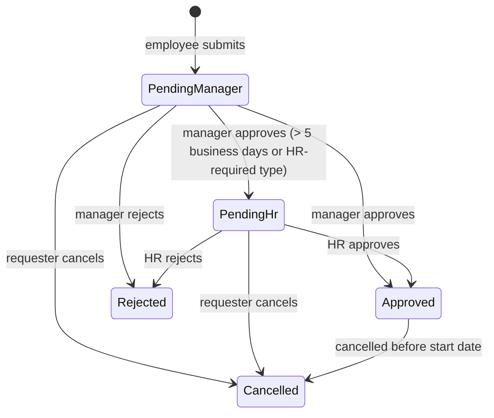
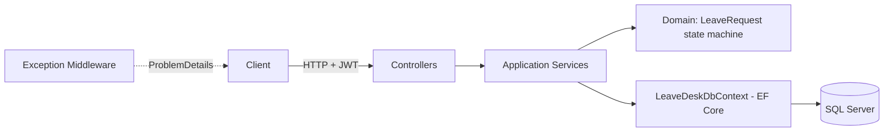

# LeaveDesk API

> Employee leave & time-off management REST API: two-level approval workflow (manager → HR), per-type leave balances and department absence caps — all safe under concurrency.

[](https://github.com/edu-tech220/leavedesk-api/actions/workflows/ci.yml)


Built with C# / .NET 8, ASP.NET Core Web API, Entity Framework Core and SQL Server (SQLite in tests).

---

## 📋 Overview

Every company has to manage employee leave — vacation, sick leave, personal days, unpaid leave — with rules that a simple CRUD can't cover: who approves what, how many days each employee has left, and how many people from the same team can be out at the same time. LeaveDesk models that workflow and enforces its rules even when several approvals happen at once.

## ✨ Key features & business rules

- **Two-level approval workflow** — the direct manager decides first; if the request exceeds **5 business days**, or the leave type always requires it (e.g. unpaid leave), it moves on to a second HR approval step.
- **Balance per leave type and year** — each employee accrues days per leave type. Pending requests *reserve* days from the balance, so two simultaneous requests can never authorize more days than are available.
- **No overlaps** — an employee cannot have two requests (pending or approved) with overlapping dates.
- **Department capacity under concurrency** — each department defines how many employees may be out at the same time (`MaxConcurrentLeaves`). The capacity check runs inside a transaction so two concurrent approvals cannot exceed the limit.
- **Controlled cancellation** — a pending request can be cancelled freely by its requester; an approved one can only be cancelled before it starts, and the balance is restored automatically.
- **Input rules** — start date cannot be after end date, cannot be in the past, and the range must contain at least one business day.
- **Role-based scoping** — `Employee`, `Manager`, `Hr` and `Admin` roles; managers only see and decide on their direct reports, HR handles the second step.

### Request state machine



## 🏗️ Architecture

A single API organized in layers inside one project (`src/LeaveDesk.Api`):



| Layer | Responsibility |
|---|---|
| `Domain/` | Entities, enums and business exceptions. `LeaveRequest` encapsulates its own state machine (`PendingManager → PendingHr → Approved / Rejected / Cancelled`). |
| `Application/` | Use cases (services), DTOs and utilities (business-day calculation, pagination). No dependency on ASP.NET Core. |
| `Infrastructure/` | EF Core (DbContext, migrations), security (PBKDF2, JWT) and demo data seeding. |
| `Controllers/` | HTTP adapters: validate the model, delegate to services and let the middleware translate domain exceptions into `ProblemDetails` (`404` / `403` / `409` / `422` / `401`). |

### Domain model

| Entity | Role |
|---|---|
| `Employee` | System user; has a role (`Employee`, `Manager`, `Hr`, `Admin`), a department and an optional direct manager. |
| `Department` | Groups employees and defines `MaxConcurrentLeaves`. |
| `LeaveType` | Catalog of leave types (vacation, sick, personal, unpaid) with annual days and whether HR approval is always required. |
| `LeaveBalance` | Accrued/used days for an employee per leave type and year. |
| `LeaveRequest` | The request itself, with its state machine and the manager/HR decisions. |
| `LeaveRequestAudit` | Log of status changes (populated by a trigger on SQL Server). |

## 🧠 Technical decisions

- **Application-managed concurrency token instead of SQL Server `rowversion`.** `LeaveRequest` and `LeaveBalance` implement `IHasConcurrencyToken`; `LeaveDeskDbContext` generates a new GUID on every `SaveChanges` for added or modified rows. Every decision endpoint requires the client to send the `rowVersion` it last saw (If-Match style), giving the same optimistic behavior on SQL Server **and** SQLite, which doesn't support auto-generated rowversion columns. A stale `rowVersion` returns `409 Conflict`, and the concurrency tests run identically on both engines.
- **Department capacity check under a serializable transaction.** Before approving, the service counts — inside a transaction — the approved requests in the same department that overlap the date range. On SQL Server that count uses `WITH (UPDLOCK, HOLDLOCK)` so two in-flight approvals cannot read the same free capacity; on other providers it relies on the `Serializable` isolation level. If the cap is exceeded, the whole transaction is rolled back (neither the request status nor the balance changes).
- **Balance "reservation" while pending.** The available balance for a leave type is `accrued - used - reserved_in_pending_requests`, so two pending requests from the same employee can never add up to more days than exist, even before either is approved.
- **SQL Server trigger as an extra safety net.** Besides application logic, the initial migration creates a trigger (`TR_LeaveRequests_StatusAudit`) that writes every request status change into `LeaveRequestAudits`, even if the row is modified outside the API. It doesn't run against SQLite (tests use `EnsureCreated`, not migrations), so it doesn't affect `dotnet test`.
- **Cross-column `CHECK` constraints.** `UsedDays <= AccruedDays` on `LeaveBalances` and `StartDate <= EndDate` on `LeaveRequests` are declared with `HasCheckConstraint`, portable across SQL Server and SQLite.
- **Hand-rolled PBKDF2 instead of ASP.NET Core Identity.** The scope doesn't need the full Identity stack; `Rfc2898DeriveBytes.Pbkdf2` with a random salt and 100,000 iterations is enough and keeps the data model simple.
- **Per-IP rate limiting on login only** (5 attempts/minute, fixed window), with a more permissive limit when `ASPNETCORE_ENVIRONMENT=Testing` (a single loopback IP performs dozens of logins per minute during the test suite).
- **Business days without a holiday calendar.** Monday to Friday are counted; a per-country holiday calendar is out of scope for this project.

## 🧰 Tech stack

| Area | Technology |
|---|---|
| Runtime | .NET 8, C# |
| Web | ASP.NET Core Web API (controllers), Swashbuckle / Swagger |
| Data | Entity Framework Core 8, SQL Server 2022 (SQLite in-memory for tests) |
| Auth | JWT Bearer, PBKDF2 password hashing |
| Resilience | ASP.NET Core rate limiting, optimistic concurrency, serializable transactions |
| Testing | xUnit, `WebApplicationFactory`, SQLite in-memory |
| DevOps | Docker, Docker Compose, GitHub Actions |

## 🚀 Getting started

### With Docker Compose (API + SQL Server)

```bash
docker compose up --build
```

The API is available at `http://localhost:8080`. On startup it applies migrations and seeds demo data if the database is empty. Swagger is served at `/swagger` only when `ASPNETCORE_ENVIRONMENT=Development`.

> The credentials and JWT signing key in `docker-compose.yml` and `appsettings.json` are sample values for local development, **not real secrets**.

### Locally

```bash
dotnet run --project src/LeaveDesk.Api
```

Requires a valid SQL Server connection string in `ConnectionStrings:DefaultConnection` (see `appsettings.json`; the defaults point to a local SQL Server on `localhost,1433`, e.g. the one from `docker compose up sqlserver`). With the default `http` launch profile the API listens on `http://localhost:5293` (Swagger at `http://localhost:5293/swagger`).

### Demo users

All seeded accounts use the password `Passw0rd!`:

| Email | Role | Team |
|---|---|---|
| admin@leavedesk.test | Admin | Engineering |
| hr@leavedesk.test | Hr | Support |
| manager@leavedesk.test | Manager | Engineering (manager of eduardo/laura/carlos) |
| manager2@leavedesk.test | Manager | Support (no direct reports) |
| eduardo@leavedesk.test | Employee | Engineering |
| laura@leavedesk.test | Employee | Engineering |
| carlos@leavedesk.test | Employee | Engineering |

Seeded departments: Engineering (max 2 concurrent leaves) and Support (max 1). Seeded leave types: `VACATION` (12 days), `SICK` (6), `PERSONAL` (3) and `UNPAID` (no balance, always requires HR).

### Quick manual walkthrough (Swagger or curl)

1. `POST /api/auth/login` with `eduardo@leavedesk.test` / `Passw0rd!`.
2. `GET /api/leave-types` to get the `id` of `VACATION`.
3. `POST /api/leave-requests` with that `leaveTypeId` and a future date range.
4. Log in as `manager@leavedesk.test` and call `PUT /api/leave-requests/{id}/manager-decision/approve`, sending the `rowVersion` returned with the request.
5. If the leave exceeds 5 business days, repeat the previous step as `hr@leavedesk.test` on `/hr-decision/approve`.
6. `GET /api/leave-balances/me` to confirm the balance was deducted.

## 🧪 Running tests

```bash
dotnet test
```

**43 tests** (xUnit). They need neither SQL Server nor Docker — they use in-memory SQLite through `WebApplicationFactory`.

- **Unit tests** for the `LeaveRequest` state machine (no database, no HTTP).
- **Integration tests** with `WebApplicationFactory<Program>` on an in-memory SQLite database, exercising the full API (auth, controllers, authorization, EF Core) just like production, without SQL Server.

Covered areas: approval workflow, authentication, cancellation, department capacity, leave balances, request creation rules, domain state machine, and search/role scoping.

## 🔌 API endpoints

All endpoints except login require a JWT (`Authorization: Bearer <token>`).

| Method | Route | Role | Description |
|---|---|---|---|
| POST | `/api/auth/login` | Public (rate limited) | Logs in and returns a JWT |
| GET | `/api/employees/me` | Authenticated | Current employee's profile |
| GET | `/api/employees` | Hr / Admin | Lists employees |
| GET | `/api/employees/{id}` | Manager / Hr / Admin | Gets an employee |
| GET | `/api/departments` | Authenticated | Lists departments |
| GET | `/api/leave-types` | Authenticated | Lists leave types |
| GET | `/api/leave-balances/me` | Authenticated | Own balances (optional `year`) |
| GET | `/api/leave-balances/{employeeId}` | Self / direct manager / Hr / Admin | An employee's balances (optional `year`) |
| POST | `/api/leave-requests` | Authenticated | Submits a leave request |
| GET | `/api/leave-requests/{id}` | Authenticated (scoped) | Gets a leave request |
| GET | `/api/leave-requests` | Authenticated (scoped) | Searches requests (`employeeId`, `status`, `from`, `to`, paginated) |
| GET | `/api/leave-requests/pending-approvals` | Manager / Hr / Admin | Requests awaiting the caller's decision (paginated) |
| PUT | `/api/leave-requests/{id}/manager-decision/approve` | Manager / Admin | Manager approval (requires `rowVersion`) |
| PUT | `/api/leave-requests/{id}/manager-decision/reject` | Manager / Admin | Manager rejection (requires `rowVersion` and comments) |
| PUT | `/api/leave-requests/{id}/hr-decision/approve` | Hr / Admin | HR approval (requires `rowVersion`) |
| PUT | `/api/leave-requests/{id}/hr-decision/reject` | Hr / Admin | HR rejection (requires `rowVersion` and comments) |
| POST | `/api/leave-requests/{id}/cancel` | Requester / Admin | Cancels a pending request |
| POST | `/api/leave-requests/{id}/cancel-approved` | Requester / direct manager / Hr / Admin | Cancels an approved leave before it starts and restores the balance |

## 📁 Project structure

```
LeaveDesk.slnx
├── src/LeaveDesk.Api/
│   ├── Domain/              # Entities, enums, business exceptions, LeaveRequest state machine
│   ├── Application/         # Services, DTOs, business-day calculator, pagination
│   ├── Infrastructure/
│   │   ├── Data/            # DbContext, migrations (incl. audit trigger), demo data seeder
│   │   └── Security/        # PBKDF2 hasher, JWT generator, current user
│   ├── Middleware/          # Exception -> ProblemDetails mapping
│   ├── Controllers/         # HTTP endpoints
│   └── Program.cs
├── tests/LeaveDesk.Api.Tests/
│   ├── Infrastructure/      # WebApplicationFactory, test users, HTTP helpers
│   └── *Tests.cs            # Workflow, auth, cancellation, capacity, balance, domain, scoping
├── .github/workflows/ci.yml # Restore, build, test (TRX artifact) and Docker image build
├── Dockerfile
└── docker-compose.yml
```
